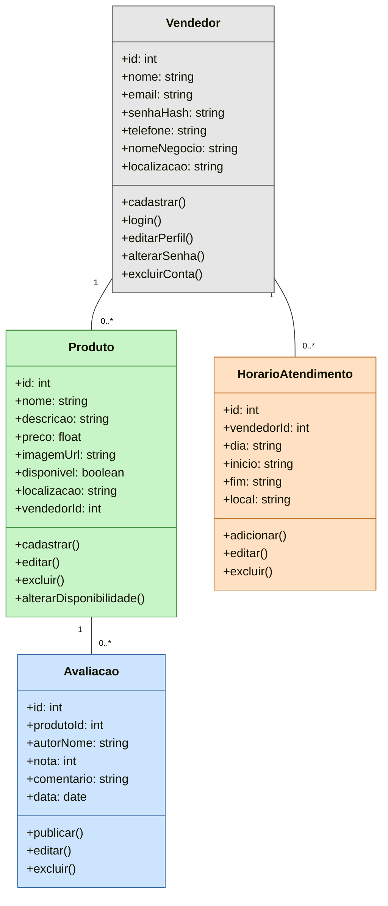

# Diagrama de classes – UniFood

O UniFood é um catálogo onde alunos que vendem comida na faculdade divulgam seus produtos. O cliente encontra o produto, vê onde e quando o vendedor atende e entra em contato pelo WhatsApp.

O sistema tem 4 entidades: **Vendedor**, **Produto**, **Avaliação** e **Horário de atendimento**.

Código do diagrama (Mermaid)

## Entidades

| Entidade | O que representa | Quem cadastra, edita e exclui |
|---|---|---|
| **Vendedor** | Aluno que vende na faculdade. Faz login com e-mail e senha. | O próprio vendedor (tela de cadastro e página Meu perfil) |
| **Produto** | Item à venda, com preço, foto e se está disponível. | O vendedor dono do produto (Novo produto e Meus produtos) |
| **Avaliacao** | Nota de 1 a 5 e comentário deixados por um visitante sobre um produto. | O visitante que escreveu a avaliação (página do produto) |
| **HorarioAtendimento** | Dia, horário e local em que o vendedor atende na faculdade. | O vendedor dono do horário (página Meu perfil) |

## Relacionamentos

| Relacionamento | Multiplicidade | Significado |
|---|---|---|
| Vendedor — Produto | 1 para 0..* | Um vendedor tem vários produtos; cada produto pertence a um vendedor (`vendedorId`). |
| Vendedor — HorarioAtendimento | 1 para 0..* | Um vendedor tem vários horários; cada horário pertence a um vendedor (`vendedorId`). |
| Produto — Avaliacao | 1 para 0..* | Um produto recebe várias avaliações; cada avaliação é de um produto (`produtoId`). |

## Métodos

Os métodos de cada classe são as ações que o usuário faz pelas telas do sistema:

- **Vendedor:** cadastrar a conta, fazer login, editar o perfil, alterar a senha e excluir a conta.
- **Produto:** cadastrar, editar, excluir e marcar como disponível ou indisponível.
- **Avaliacao:** publicar, editar e excluir (só a própria avaliação).
- **HorarioAtendimento:** adicionar, editar e excluir (só os próprios horários).

## Observações

- A senha não é guardada: o sistema guarda só o hash dela (`senhaHash`).
- O produto também guarda uma cópia do nome do negócio e do telefone do vendedor para mostrar no catálogo. Esses campos não aparecem no diagrama porque vêm do Vendedor.
- Excluir a conta do vendedor apaga os produtos e os horários dele, e excluir um produto apaga as avaliações dele.
- O Painel do vendedor não é uma entidade: ele calcula os indicadores a partir de Produto, Avaliacao e HorarioAtendimento.
